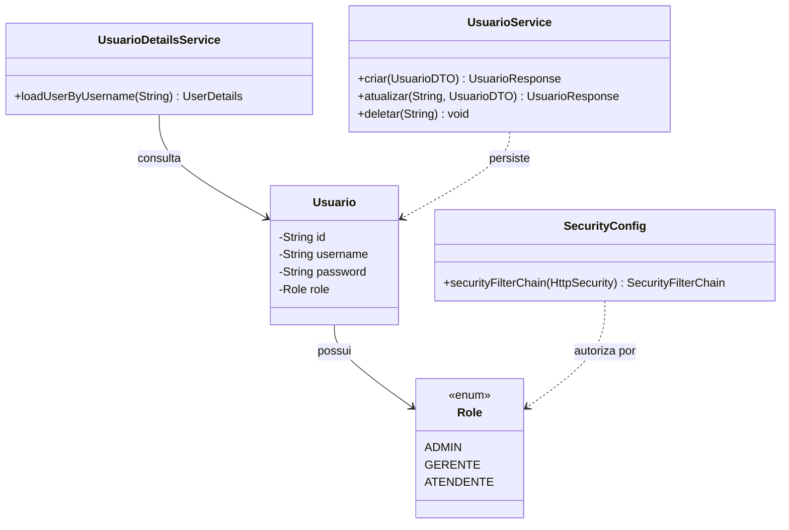
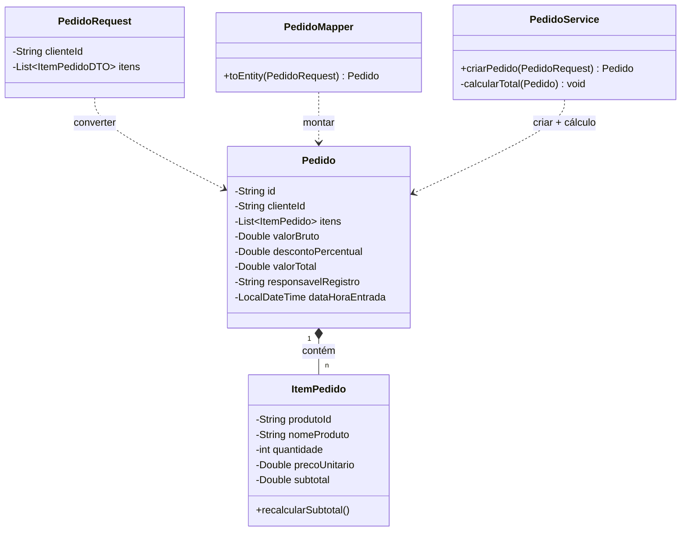
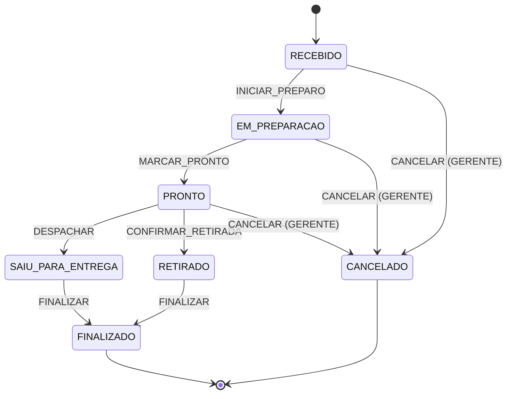
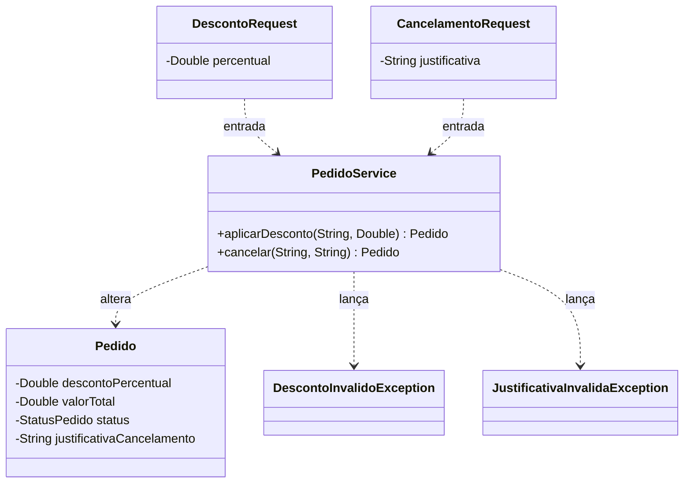
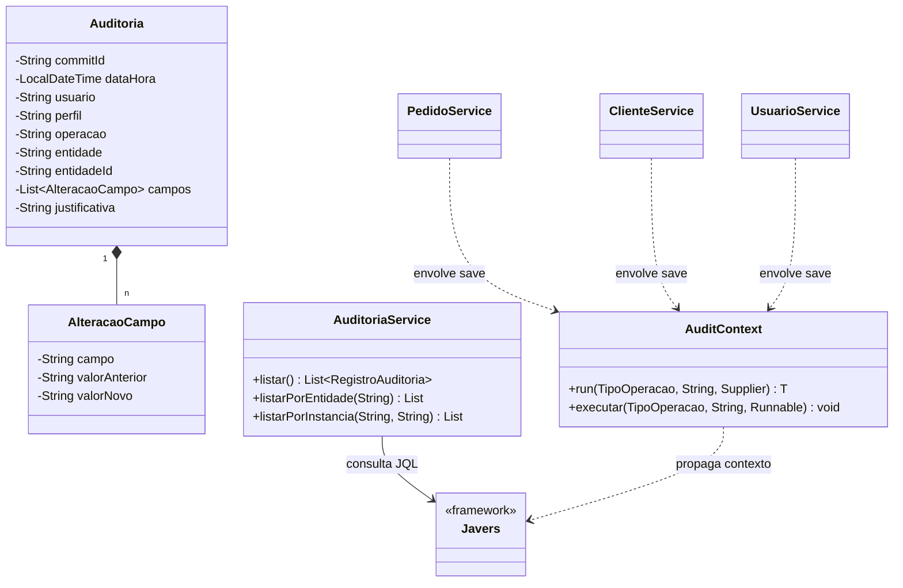
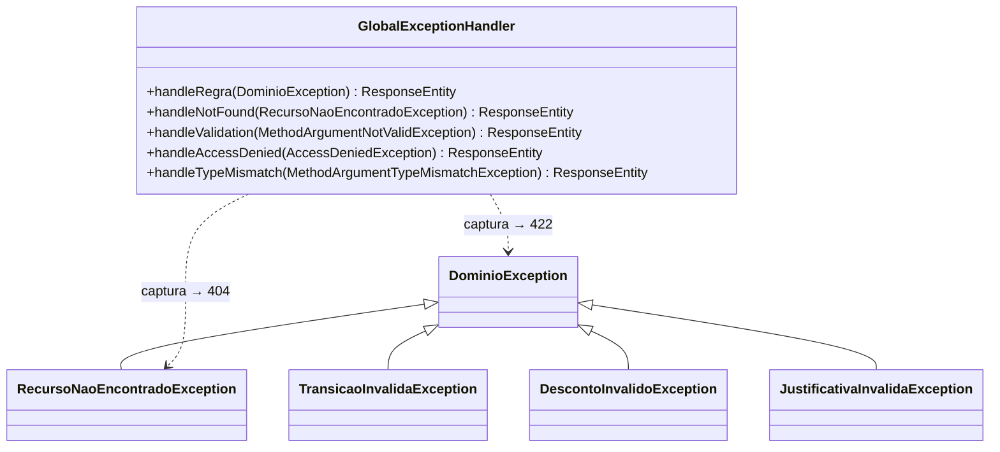

# 📊 README — PediuPatrão

> [!abstract] Resumo
> O **PediuPatrão** saiu de um esqueleto Spring Boot com login funcional e CRUD básico para um sistema completo de gestão de pizzaria.
> **Pontuação estimada inicial:** ~0,2 / 10,0.
> **Situação atual:** aplicação funcional com os **5 Requisitos Funcionais implementados**, auditoria persistente, máquina de estados, RBAC real e suíte de testes de integração.
> **Maior evolução:** `#rf05` (Auditoria) — saiu de zero para o componente mais robusto do projeto, sustentado pelo JaVers.

> [!tip] Como ler este documento
> Cada seção traz uma tabela **Antes × Agora** mostrando o estado inicial detectado no diagnóstico e o estado atual. Os símbolos seguem a mesma legenda em todo o documento.

> [!info] Legenda de status
> | Símbolo | Significado |
> |---|---|
> | ✅ | Implementado corretamente |
> | 🟡 | Parcialmente implementado |
> | ❌ | Não implementado |

---

## 1. 🧰 Stack — do esqueleto ao ecossistema completo

| Categoria | Tecnologia | Versão | Situação |
|---|---|---|---|
| Linguagem | Java | 23 | ✅ |
| Framework | Spring Boot | **3.4.4** | ✅ |
| Build | Maven Wrapper | 3.9.9 | ✅ |
| Segurança | Spring Security 6 | herdada | ✅ RBAC real + CSRF |
| Persistência | Spring Data MongoDB | herdada | ✅ |
| **Auditoria** | **JaVers 7** | adicionada | ✅ **nova** |
| **Máquina de Estados** | **Spring State Machine 4** | adicionada | ✅ **nova** |
| **Mapeamento** | **MapStruct** | adicionada | ✅ **nova** |
| Validação | Jakarta Bean Validation | herdada | ✅ usada extensivamente |
| Template Engine | Thymeleaf | 3.1 | ✅ + Layout Dialect |
| UI | AdminLTE 3.2 / Bootstrap 4 | — | ✅ |
| Documentação API | springdoc-openapi | adicionada | ✅ **nova** |
| Banco | MongoDB 7 (Docker) | — | ✅ |
| Utilitário | Lombok | 1.18.36 | ✅ |

> [!note] Bibliotecas adicionadas nesta evolução
> **JaVers** (auditoria com diff automático), **MapStruct** (mapeamento entidade ↔ DTO sem reflection), **Spring State Machine** (fonte única de verdade para transições de pedido) e **springdoc-openapi** (documentação viva da API). Cada uma delas resolve um requisito específico — o detalhamento está nas seções RF02–RF05.

---

## 2. 🧩 RF01 — Controle de usuários e permissões

**Situação inicial:** 🟡 `#rf01` — `UsuarioDetailsService` forçava `.roles("USER")`, `SecurityConfig` não diferenciava perfis, `/api/usuarios` estava `permitAll()`.
**Situação atual:** ✅ `#rf01` — três perfis funcionais, autorização em profundidade e proteções anti-abuso.

| Item | Antes | Agora |
|---|---|---|
| Enum `Role` | ❌ não existia | ✅ `ADMIN`, `GERENTE`, `ATENDENTE` |
| `Usuario.role` | `String` | ✅ `Role` tipado |
| `UsuarioDetailsService` | `.roles("USER")` hardcoded | ✅ usa `usuario.getRole()` |
| `@EnableMethodSecurity` | ❌ | ✅ |
| `requestMatchers().hasRole()` | ❌ | ✅ |
| Anti-autoelevação | ❌ | ✅ service bloqueia |
| Último ADMIN | ❌ | ✅ não pode ser rebaixado/excluído |
| `UsuarioResponse` | ❌ expunha tudo | ✅ nunca inclui `password` |
| CSRF | ❌ `disable()` | ✅ ativo na UI, ignorado em `/api/**` |

### Arquivos que mudaram

- `config/SecurityConfig.java` — reescrito com `@EnableMethodSecurity` + regras por rota.
- `service/UsuarioDetailsService.java` — corrigido para ler `u.getRole()`.
- `service/UsuarioService.java` — ganhou `validarAlteracaoPerfil()` e `validarUsernameLivre()`.
- `entity/enums/Role.java` — **novo**.
- `dto/UsuarioResponse.java` — **novo**, substitui a exposição direta da entidade.

> [!important] Regra-chave aplicada
> As restrições vivem **no backend** (Spring Security + `@PreAuthorize` + regras no service). Ocultar botões no front-end é consequência, não a proteção.

### Diagrama (RF01)



---

## 3. 🧩 RF02 — Evolução do cadastro de pedidos

**Situação inicial:** ❌ `#rf02` — `Pedido` só tinha `clienteId, tipoPizza, status, quantidade, sabor`. Sem itens, sem total, sem responsável, sem timestamp. Aceitava objeto cru no controller.
**Situação atual:** ✅ `#rf02` — pedido composto por itens, cálculo server-side, DTOs validados e proteção contra over-posting.

| Item | Antes | Agora |
|---|---|---|
| Estrutura | campos soltos | ✅ `List<ItemPedido>` |
| Cálculo de total | ❌ manual/inexistente | ✅ `calcularTotal()` no service |
| `valorTotal` vindo do cliente | ❌ aceito | ✅ ignorado (MapStruct) |
| `status` vindo do cliente | ❌ aceito | ✅ forçado para `RECEBIDO` |
| `responsavelRegistro` | ❌ | ✅ preenchido via `SecurityContextHolder` |
| `dataHoraEntrada` | ❌ | ✅ `LocalDateTime.now()` |
| Validação de entrada | ❌ objeto cru | ✅ `PedidoRequest` + `ItemPedidoDTO` |
| `@Entity` (JPA) em documento Mongo | ❌ redundante | ✅ removido |

### Arquivos que mudaram

- `entity/Pedido.java` — reescrito com `List<ItemPedido>`, `valorBruto`, `valorTotal`, `descontoPercentual`, `justificativaCancelamento`, timestamps e responsáveis.
- `entity/ItemPedido.java` — **novo**, com `recalcularSubtotal()`.
- `dto/PedidoRequest.java` e `dto/ItemPedidoDTO.java` — **novos**, com `@NotBlank`, `@NotEmpty`, `@Min(1)`.
- `mapper/PedidoMapper.java` — **novo**, com `@Mapping(ignore=true)` para todos os campos calculados no servidor.
- `service/PedidoService.criarPedido()` — hidrata itens a partir do `Produto`, valida produto ativo, calcula totais.

### Diagrama (RF02)



> [!important] Regra-chave aplicada
> `valorTotal` **nunca** vem do cliente HTTP — é sempre recalculado no `PedidoService` a partir dos preços atuais dos produtos.

---

## 4. 🧩 RF03 — Controle de entrada, saída e transições

**Situação inicial:** ❌ `#rf03` — `atualizarStatus()` aceitava qualquer string sem validar fluxo. Um `PUT ?status=CANCELADO` funcionava em qualquer pedido.
**Situação atual:** ✅ `#rf03` — máquina de estados declarativa, timestamps de saída automáticos e bloqueio de transições inválidas.

| Item | Antes | Agora |
|---|---|---|
| Validação de transição | ❌ aceita qualquer string | ✅ Spring State Machine |
| Enum de status | ❌ `String` | ✅ `StatusPedido` |
| Enum de eventos | ❌ | ✅ `EventoPedido` |
| Configuração de fluxo | ❌ `if/else` inexistente | ✅ `StateMachineConfig` |
| `dataHoraSaida` | ❌ | ✅ ao entrar em saída |
| `responsavelSaida` | ❌ | ✅ via `SecurityContextHolder` |
| Resposta para transição inválida | ❌ 200 OK | ✅ 422 |
| Fluxo visual no código | ❌ | ✅ 1 arquivo de config |

### Arquivos que mudaram

- `entity/enums/StatusPedido.java` — **novo**, com `isTerminal()` e `jaSaiu()`.
- `entity/enums/EventoPedido.java` — **novo**.
- `config/StateMachineConfig.java` — **novo**, declara 9 transições.
- `exception/TransicaoInvalidaException.java` — **novo**.
- `service/PedidoService.processarEvento()` — hidrata a máquina com o estado atual do pedido e verifica `ResultType.ACCEPTED`.

### Diagrama (RF03)



> [!important] Regras-chave aplicadas
> - `CANCELADO` só via endpoint de cancelamento (GERENTE), só antes da saída.
> - Após `FINALIZADO` ou `CANCELADO`, nenhuma transição é aceita.
> - Ao entrar em `SAIU_PARA_ENTREGA` ou `RETIRADO`, `dataHoraSaida` e `responsavelSaida` são gravados.

---

## 5. 🧩 RF04 — Cancelamentos e descontos

**Situação inicial:** ❌ `#rf04` — operações inexistentes. Não havia endpoint, não havia regra, não havia restrição por perfil.
**Situação atual:** ✅ `#rf04` — dois endpoints restritos ao GERENTE, com validação de limite, janela de operação e justificativa obrigatória.

| Item | Antes | Agora |
|---|---|---|
| Desconto | ❌ | ✅ 0–20%, recalculado no servidor |
| Cancelamento | ❌ | ✅ exige justificativa ≥ 5 chars |
| Restrição por perfil | ❌ | ✅ `@PreAuthorize("hasRole('GERENTE')")` + `SecurityConfig` |
| Bloqueio pós-saída | ❌ | ✅ verifica `jaSaiu()` e `isTerminal()` |
| Endpoint | ❌ | ✅ `POST /api/pedidos/{id}/desconto` |
| Endpoint | ❌ | ✅ `POST /api/pedidos/{id}/cancelar` |
| Registro em auditoria | ❌ | ✅ `TipoOperacao.DESCONTO` / `CANCELAMENTO` |

### Arquivos que mudaram

- `dto/DescontoRequest.java` e `dto/CancelamentoRequest.java` — **novos**, com `@DecimalMin/@DecimalMax` e `@Size`.
- `exception/DescontoInvalidoException.java` e `exception/JustificativaInvalidaException.java` — **novos**.
- `service/PedidoService.aplicarDesconto()` e `cancelar()` — **novos**, com `@PreAuthorize` + validações de domínio.

### Diagrama (RF04)



> [!important] Regras-chave aplicadas
> - Limite de 20% é reforçado em **duas camadas** (DTO + service).
> - Justificativa mínima de 5 caracteres é verificada em **duas camadas** (DTO + service).
> - `jaSaiu()` e `isTerminal()` bloqueiam as duas operações após saída ou em estado final.

---

## 6. 🧩 RF05 — Auditoria das alterações

**Situação inicial:** ❌ `#rf05` — totalmente ausente. Nenhum registro de quem alterou o quê, quando e por quê. Maior peso da rubrica (3,0 pts) em zero.
**Situação atual:** ✅ `#rf05` — o componente mais robusto do projeto, sustentado pelo JaVers.

| Item | Antes | Agora |
|---|---|---|
| Persistência | ❌ | ✅ JaVers em `jv_snapshots` |
| Diff automático | ❌ | ✅ via `@JaversSpringDataAuditable` |
| Usuário autenticado | ❌ | ✅ via `AuthorProvider` |
| Perfil do usuário | ❌ | ✅ via `CommitPropertiesProvider` |
| Operação tipada | ❌ | ✅ `TipoOperacao` |
| Justificativa | ❌ | ✅ propagada via `AuditContext` |
| Campos sensíveis | ❌ | ✅ `@DiffIgnore` em `password` |
| Filtro extra | ❌ | ✅ `AuditoriaService` bloqueia senha/token/secret |
| Endpoint de consulta | ❌ | ✅ `GET /api/auditoria` |
| Escrita na auditoria | ❌ | ✅ append-only |
| Tela Thymeleaf | ❌ | ✅ `/auditoria` |

### Arquivos criados

- `audit/AuditContext.java` — **novo**, `ThreadLocal` com `operacao` e `justificativa`.
- `config/JaversConfig.java` — **novo**, customiza `AuthorProvider` e `CommitPropertiesProvider`.
- `entity/AlteracaoCampo.java`, `entity/enums/TipoOperacao.java` — **novos**.
- `dto/RegistroAuditoria.java` — **novo**.
- `service/AuditoriaService.java` — **novo**, lê commits via JQL e filtra campos proibidos.
- `controller/AuditoriaController.java` e `AuditoriaViewController.java` — **novos**.
- `templates/auditoria/lista.html` — **novo**.

### Diagrama (RF05)



> [!important] Regras-chave aplicadas
> - `password` anotado com `@DiffIgnore` — nunca vai para o snapshot.
> - `AuditoriaService` filtra adicionalmente `senha`, `password`, `token`, `secret`, `credencial`, `authorization`.
> - Endpoints de escrita/exclusão **não existem** — modelo estritamente append-only.
> - Consulta restrita a `hasAnyRole('ADMIN','GERENTE')`.

---

## 7. ⚙️ Requisitos Não Funcionais — do diagnóstico ao estado atual

### 🧱 RNF01 — Manter stack
**Antes:** ✅ `#rnf01` — stack respeitada.
**Agora:** ✅ — stack mantida, com **quatro** bibliotecas adicionadas (JaVers, MapStruct, State Machine, springdoc) **sem trocar** Spring Boot, MongoDB, Thymeleaf ou AdminLTE.

### 🧱 RNF02 — Regras na camada de serviço
**Antes:** 🟡 `#rnf02` — serviços só faziam `save`/`findAll`; regras inexistentes.
**Agora:** ✅ — todas as regras de negócio migraram para o service:
- `PedidoService.criarPedido` — cálculo e validação server-side.
- `PedidoService.processarEvento` — transição validada pela máquina de estados.
- `PedidoService.aplicarDesconto` / `cancelar` — limites e bloqueios.
- `UsuarioService.validarAlteracaoPerfil` — anti-autoelevação.

### 🧱 RNF03 — Autorização no backend
**Antes:** ❌ `#rnf03` — `/api/usuarios` estava `permitAll()`, `.roles("USER")` hardcoded.
**Agora:** ✅ — defesa em profundidade:
- `SecurityConfig` com `requestMatchers().hasRole()`.
- `@EnableMethodSecurity` + `@PreAuthorize` nos controllers e services.
- Regras de domínio no service (último ADMIN, autoelevação).

### 🧱 RNF04 — CSRF
**Antes:** ❌ `#rnf04` — `csrf.disable()` global.
**Agora:** ✅ — CSRF ativo na UI Thymeleaf e ignorado apenas em `/api/**`:

```java
.csrf(csrf -> csrf.ignoringRequestMatchers("/api/**"))
```

O `test.sh` cobre formulários web com CSRF e endpoints REST sem.

### 🧱 RNF05 — Organização + tratamento de erros
**Antes:** 🟡 `#rnf05` — sem `dto/`, sem `exception/`, sem padronização.
**Agora:** ✅ — camadas explícitas (`dto/`, `mapper/`, `exception/`, `audit/`) e tratamento centralizado:



Códigos HTTP padronizados:
| Erro | Status |
|---|---|
| Regra de negócio (`DominioException`) | 422 |
| Recurso não encontrado | 404 |
| Acesso negado | 403 |
| Validação de DTO (`@Valid`) | 400 |
| Parâmetro inválido | 400 |

---

## 8. 📈 Comparativo consolidad
> [!success] Marcos da evolução
> - **RF05** foi o maior salto individual: de ausente para o módulo mais robusto, com JaVers, `AuditContext`, filtro de campos sensíveis e consulta paginada.
> - **RF01** deixou de ser "login funcional sem papéis" para RBAC real com `@PreAuthorize`, `hasRole`, CSRF e anti-autoelevação.
> - **RF03** trocou validação ad-hoc por **fonte única de verdade** (`StateMachineConfig`): adicionar ou remover transição = editar um arquivo.
> - **MapStruct** eliminou conversões manuais espalhadas e neutralizou over-posting de `status`, `valorTotal` e `responsavel` (RF02).
> - **JaVers** resolveu o RF05 sem reimplementar auditoria manualmente, aproveitando `@DiffIgnore` para blindar senhas.

---

## 9. 🧭 O que ainda pode evoluir

> [!note] Itens fora do escopo atual, mas mapeados
> - **Refresh token / JWT** para a API REST (hoje é session-based, o que funciona para UI e testes).
> - **Testcontainers** para testes de integração em CI (hoje `test.sh` depende do Mongo no `localhost:27017`).
> - **Spring Boot Actuator** para health checks e métricas.
> - **Rotação de credenciais** do MongoDB Atlas (`application-atlas.properties` tem credenciais que devem ser externalizadas via variáveis de ambiente antes de qualquer uso real).
> - **Pact / contract tests** entre UI Thymeleaf e API REST.

---

## 10. 📁 Estrutura do projeto (estado atual)

```text
PediuPatrao/
├── .mvn/wrapper/                   Maven wrapper
├── src/
│   ├── main/
│   │   ├── java/com/umc/pediupatrao/
│   │   │   ├── audit/              AuditContext (ThreadLocal)          ← novo
│   │   │   ├── config/             Security, MongoDB, StateMachine, JaVers
│   │   │   ├── controller/         REST + View controllers
│   │   │   ├── dto/                Request/Response DTOs
│   │   │   ├── entity/             Documentos MongoDB + enums
│   │   │   ├── exception/          Exceções + handler global
│   │   │   ├── mapper/             MapStruct mappers                 ← novo
│   │   │   ├── repository/         Spring Data repositories
│   │   │   ├── service/            Regras de negócio
│   │   │   └── PizzariaPedidosApplication.java
│   │   └── resources/
│   │       ├── static/             AdminLTE, plugins, CSS, JS
│   │       ├── templates/          Thymeleaf (login, layout, fragments, *)
│   │       ├── application.properties
│   │       ├── application-local.properties
│   │       └── application-atlas.properties
│   └── test/
├── compose.yaml                    Docker Compose (MongoDB)
├── pom.xml
├── mvnw / mvnw.cmd
├── test.sh                         Suite de testes de integração
└── README.md
```

---

## 11. 🛠 Troubleshooting

| Sintoma | Causa provável | Solução |
|---|---|---|
| `setUsername is undefined for Usuario` | Maven não recompilou (Lombok) | `./mvnw clean spring-boot:run` |
| Páginas Thymeleaf retornam 500 | Sintaxe incompatível com Thymeleaf 3.1 | Trocar `${#request}`, `${#session}` por `${session.x}` |
| Login com senha errada marcado como falha no `test.sh` | Spring redireciona com 302; teste espera `!= 302` | Esperado — o `failureHandler` faz forward em vez de redirect |
| MongoDB não sobe | Porta 27017 ocupada | `docker ps`, parar processos conflitantes |
| JaVers não registra nada | Repositório sem `@JaversSpringDataAuditable` | Anotar o `MongoRepository` correspondente |

---

## 12. 🚀 Como executar

```bash
# 1. Subir o MongoDB
docker compose up -d

# 2. Subir a aplicação
./mvnw clean spring-boot:run

# 3. Acessar
#    UI:        http://localhost:8080/login
#    Swagger:   http://localhost:8080/swagger-ui/index.html
#    OpenAPI:   http://localhost:8080/v3/api-docs

# 4. Rodar a suíte de integração
./test.sh
```

### Credenciais padrão (bootstrap)

| Usuário | Senha | Perfil |
|---|---|---|
| `admin` | `admin123` | ADMIN |
| `gerente` | `gerente123` | GERENTE |
| `atendente` | `atendente123` | ATENDENTE |

> [!warning] Produção
> As credenciais acima só existem porque `app.bootstrap.enabled=true` no profile local. Em produção, desabilite o bootstrap (`app.bootstrap.enabled=false`) e rotacione as credenciais do MongoDB Atlas — hoje `application-atlas.properties` contém valores que devem ser externalizados.

---

## 13. 📄 Licença

Projeto acadêmico — uso livre para fins educacionais.
